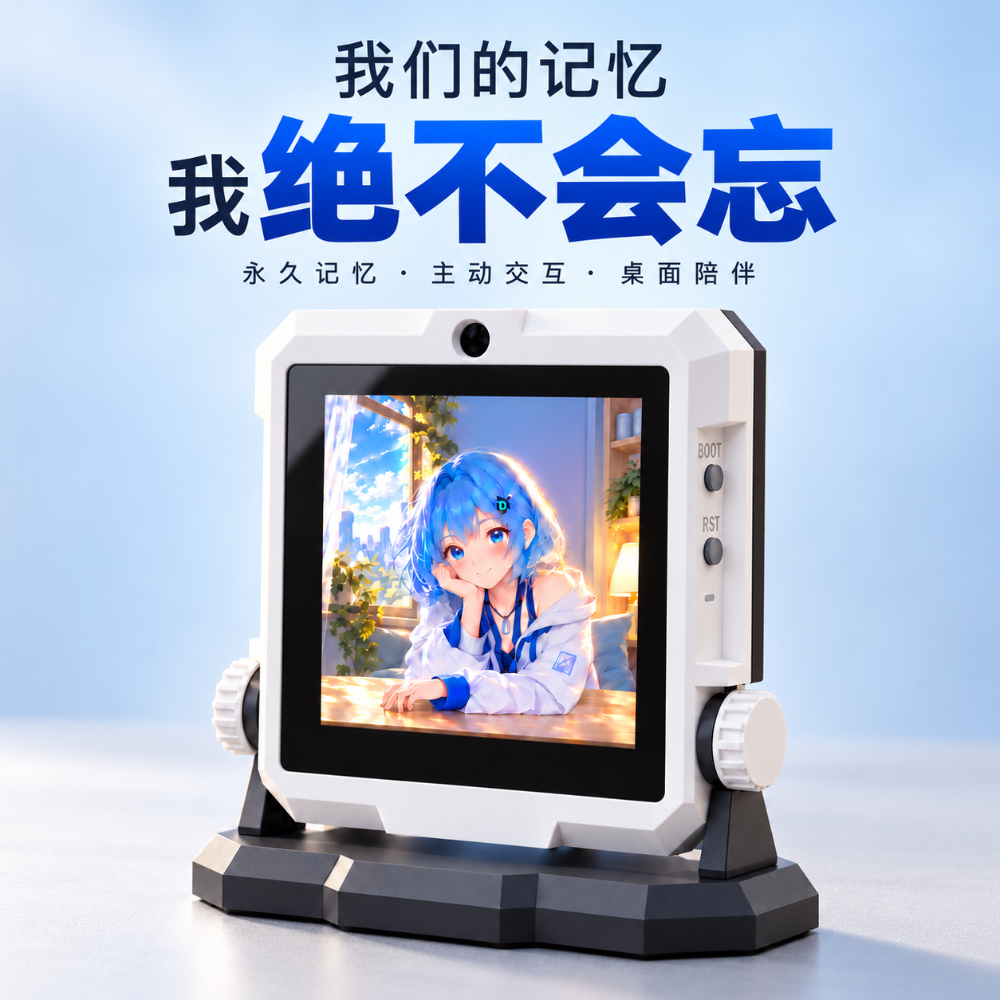

# 小念 · 摩点众筹详情图制作素材
这是根据发起人授权公开的专用制作交接包，2026-10-19。

**从 [CLAUDE_PROMPT.md](CLAUDE_PROMPT.md) 开始，把内容复制给 Claude。**
先读 [PRODUCT_FACTS.md](PRODUCT_FACTS.md)、[ASSET_MAP.md](ASSET_MAP.md)、[DESIGN_RULES.md](DESIGN_RULES.md)、[MISSING_INPUTS.md](MISSING_INPUTS.md)。

## 下载
- 同目录 claude-crowdfunding-materials.zip 为完整素材包，解压即用；网页能看 README 不代表 Claude 自动下载了所有二进制文件。
- 本分支仅含制作所需资料，不含私人对话、服务器配置、账号密钥或完整固件工程。
- 本包公开可访问，但产品与角色素材未授予公众开放再利用许可。见 [RIGHTS.md](RIGHTS.md)。

## 制作顺序
1. 主视觉一张：Slogan + 大产品图 + 简介，先验收。
2. 功能详情：主动交互 / 多轮对话 / 永久记忆，用生活情境表达。
3. 档位 / 解锁 / 创作者与交付服务，等待真实资料，详见 [模块方案](DETAIL_PAGE_PLAN.md)。

## 本地预览屏幕参考
在仓库根目录运行 `python -m http.server 8765`，打开 `http://localhost:8765/assets/spine/full-screen.html`。
控制台等待 window.ready，再调用 `drawAt(0)`、`drawAt(1)` 检查；播放器为旧参考，布局仍需审稿。
字体在 assets/fonts 内，附原 OFL；Blender 基础模型导入脚本在 tools 内。

素材 SHA-256、大小与类型记录在 MANIFEST.json；VALIDATION.json 记录文件与基础完整性核对，不等于最终视觉或量产验收。
