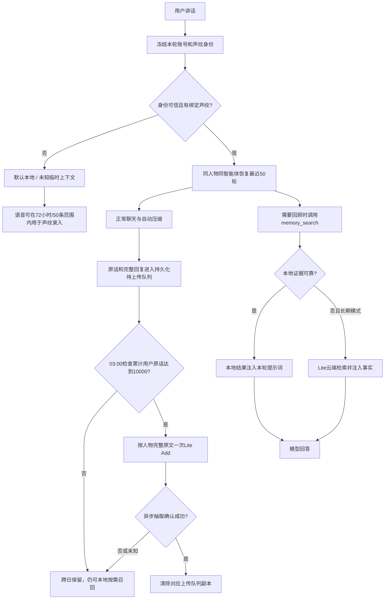

# 个人记忆续接、累计抽取与存档保留实施记录

日期：2026-09-30。状态：服务端已部署正式域名；自动化及真实模型/百炼测试完成。设备实机补验和下一次自然03:00窗口仍待验证，不标记为通过。画像关闭，无固件改动或OTA，无自动观察任务，无Git推送。

## 1. 已实现规则

| 内容 | 上线行为 |
| --- | --- |
| 抽取门槛 | 每位有效声纹成员累计至少10,000个用户原话估算token；助手及工具文本不计入门槛 |
| 时间窗口 | 北京时间03:00至次日03:00；03:00检查，低于门槛跨日继续累计，当天达到门槛不立即上传 |
| 默认/未知 | 默认仅本地；未知仅当前连续连接临时上下文；均不进行百炼写入、检索或个人习惯学习 |
| 续接 | 同账号、人物、智能体和代次，恢复最近50个完整文字轮次；不同人物与智能体不共用摘要 |
| 文本存档 | 每个归属范围最多50轮；未知按设备独立范围保留录入素材，不能个人召回 |
| 录音 | 用户录音最多72小时且最多最近50条，先达到哪个就清理哪个；助手音频仅临时播报 |
| 待上传原文 | 与存档独立；不足门槛、失败、结果未知均保留；跨日材料可按人物本地检索 |
| 百炼Add | 每个人的完整原文按角色、轮次、智能体、时间序列化成一个messages文本，目标一次Add；没有合格材料零调用 |
| 成功确认 | 跟踪异步event；确认成功后仅清除已处理水位内队列副本，不删除新材料 |
| 本地检索 | 可靠用户陈述或业务证据优先；助手猜测或用户提问本身不作为可靠事实；本地不足才允许合格成员云端Search |
| 压缩 | 16万准备、18万提交、20万完整请求保护、约5万目标；完整分批摘要，不触发Add，不清除待上传原文 |
| 摘要保存 | 保存已验证的压缩结果；断连不再额外支付一次摘要调用；人物更正、退役和较新水位阻止迟到摘要覆盖 |

token门槛采用版本化的本地估算（中文字符/1.5，其他字符/4），不是阿里收费token实计。旧材料没有新计数字段时使用同口径回算。新材料用户轮次需要持久化结束标记才可推进水位；异常退出也写结束标记，进程硬中断未闭合的材料保留等待核对。

## 2. 工作链路

## 3. 实现与迁移

- 新Liquibase changeset：`202609301900-memory-continuity`，补用户token计数、计数版本、近期材料索引和已退役存档事件标识。未修改已发布旧迁移，不推测旧记录人物。
- 主要后端：`MemoryDailyWorker`、`MemoryMaterialPolicy`、`ArchiveRetentionWorker`、`RecentArchiveService`、`PersonMemoryService`和存档上报服务。
- 主要语音服务：`person_identity.py`、`person_short_memory.py`、百炼provider、上报与connection流程。新增内部`/person-memory/internal/continuation`接口，不开放人物选择给模型。
- 材料编号与ASR/提示词轮次编号独立，避免提示词更新覆盖编号后丢失助手原文。
- 存档清理保留事件墓碑，迟到重试不能重建已清理正文；声纹模板独立于聊天录音。
- SQLite摘要按账号、人物、代次、智能体隔离；人物级更正使其各智能体摘要失效；保存来源水位阻止旧连接覆盖新摘要。
- 本次21个源文件与测试文件的完整路径及哈希见`tools/memory-continuity/manifest.json`；后端完整交付副本位于`tools/memory-continuity/delivery/main/`。本地4.30根目录是固件Git，服务器应用源代码通过交付目录一起保存。
- 没有修改前端界面，沿用现有用户管理、语音选择和试听风格。原有声纹录入不要求人物ID非空。

## 4. 已完成测试

### 自动化与隔离环境

214项Java和136项Python，共350项通过，零失败、零错误、零跳过。Java包含真实隔离MySQL事务测试，不复制生产用户资料；候选Spring服务用独立Redis启动，验证Liquibase迁移及8个受保护路由对缺失/错误凭证拒绝访问。

覆盖：9999→10000门槛、跨日累计、未闭合轮次保留、成功后仅清除对应水位、北京时间03:00闭合窗口、50轮文字/72小时音频清理不影响上传队列、存档重试去重、跨日材料召回、账号/人物/智能体隔离、未知临时上下文、完整长回复分块、默认零上传、摘要更正/退役/迟到保护、16/18/20万边界、工具配对与TTS回归。

### 真实模型与百炼

| 测试 | 结果 |
| --- | --- |
| 跨唤醒对话资料→真实Qwen回答 | 合成故事中的机器人“雨点”被正确延续 |
| 实际后台摘要与压缩 | 184,967估算token→37,251；摘要279字；保留最近5个用户轮次；保留“河岸”和最新更正“工作日18点” |
| 压缩后真实最终回答 | 正确回答“河岸、工作日18点”，未回到旧17点约定 |
| 真实长输入 | 185,095估算token，API实计140,328输入token，成功返回；进入128K以上输入档 |
| 稳定前缀与缓存字段 | 重复请求成功；当前上游/网关未返回缓存token详情，标为unknown，不声称命中或免费 |
| 完整原文单次Lite Add | 15,244用户原话估算token，单个messages文本；异步成功，形成2条测试事实 |
| 用户/助手区分 | 用户“松岚730、临时测试柜第三层”提取正确；助手猜测“紫云999、第四层”没有被当成用户事实 |
| Lite Search→function calling→最终回答 | 真实模型调用memory_search，注入检索结果后正确回答编号及位置 |
| 正式域名本地完整链路 | 通过实际上报接口保存标记测试轮次，continuation恢复、recent召回、真实模型回答“枫叶820”；重试不增行 |
| 测试清理 | 仅删除本轮新增云端测试节点及精确标记存档，原有事实保留 |

新增测试的钱包扣款增量汇总为**¥6.187468，约¥6.19**，低于¥20；预算保守估算累计约¥13.57。账单来自模型已有配置钱包和成员记忆钱包，统计可能包含同钱包同期调用，不当成逐项阿里发票金额。

测试中发现现有产品账号令牌直接请求`qwen-plus`被拒绝；其允许的`aimi-chat`映射到另一模型。两次该别名短测试花费约¥0.50，已包含总额。最终Qwen验收改用服务器真实官方Qwen配置和已有钱包，未修改账号权限、渠道或充值数据。余额不足请求没有盲目重试。测试脚本关闭SDK自动重试。

事实单次Add销售价仍为¥0.02574，抽出2条不是收费2次。上面的总额包含长输入、分批摘要及多次模型回答，不是“保存两条事实的价格”。画像全程关闭。

## 5. 发布与线上检查

- 首次发布：2026-09-30 23:30:48，北京时间；随后补强身份缓存与材料编号保护，全部再次回归通过。
- 正式域名：`https://api.realecho.cn`、`https://www.realecho.cn`、`https://realecho.cn`；均检查HTTP200。manager-api和xiaozhi-server均online。
- 运行jar SHA256：`97bc4ffe982a2be300e1e00e2d5ef6656b3d873ce13bafabe1f8de1493c022ef`。
- 线上存量聚合：50条音频，共4,222,360字节；过期音频引用0；删除补偿积压0；抽取任务积压0。待上传材料4条，新增用户token为0，未为这些材料强行发Add。
- 手动30秒观察无新增错误输出、Traceback、记忆或存档清理延后。错误日志尾部仍有23个Traceback；未将这个尾部累计值当成本次窗口的新错误计数。
- 当前尚未到下一次自然03:00。边界行为已在隔离库验收；**不宣称自然定时窗口或实际每日新材料抽取已验收**，更不将没有材料的跳过记成抽取成功。
- 没有启用画像，没有发布固件OTA，没有恢复已取消的Codex自动观察。

发布证据：`tools/memory-continuity/release-receipt.json`。线上详情在服务器`/root/prjs/tmp/memory-continuity-release-20260930/`，只保存代码、元数据和合成测试结果，不备份已删除用户正文。

## 6. Git保存与回滚

两个仓库均采用标签`memory-continuity-20260930`，不推送远端；提交说明为`feat: ship 10k-token personal extraction, cross-wake continuity and 72h audio retention`。提交哈希见同目录Git保存结果。

开发前基线：服务端`496899c4654656707c1e0e9e8dc57b1c42f14bd9`；4.30本地`39ed18d4b97f10a6f821ae64558f9100a65e18a5`。历史已有未提交配置和无关文件变更未纳入本次功能提交。

恢复前先关闭受影响的新云端调用，保存账本和已生效删除；紧急代码回退可在SSH运行`python3 /tmp/rollback.py`。脚本只还原已保存的源码/jar，保留新增数据库结构、抑制、删除状态和财务账本；停用云端与画像，不恢复已删正文。该紧急脚本未在生产执行，恢复后应重新验证服务健康并检查功能配置。

## 7. 用户实机补验

1. 不擦Flash/NVS；重新唤醒，确认自己的声纹身份。
2. 告诉设备“我的测试书签叫青竹，放在左边抽屉”，待完整回复后退出并重新唤醒，询问名称和位置。此时使用本地存档，不必等云端抽取。
3. “讲一个故事”→“再讲一个”；再调一次音量，检查衔接、实际操作和完整播报。
4. 已绑定爸爸时，让未录声纹者讲话；其音频仍可在期限内选作录入素材，不能回答爸爸的个人历史，也不进入爸爸上传队列。
5. 可信成员的长期材料累计10,000原话估算token后，下一次03:00才应抽取；低于门槛跨日保留。不要用此次已清除的“松岚730/枫叶820”测试数据期待设备继续记得。

声纹识别准确率、真人多人轮换、真实试听与完整播报、实体设备跨唤醒时延仍需要设备验收。模拟和HTTP测试不能替代这些结果。
